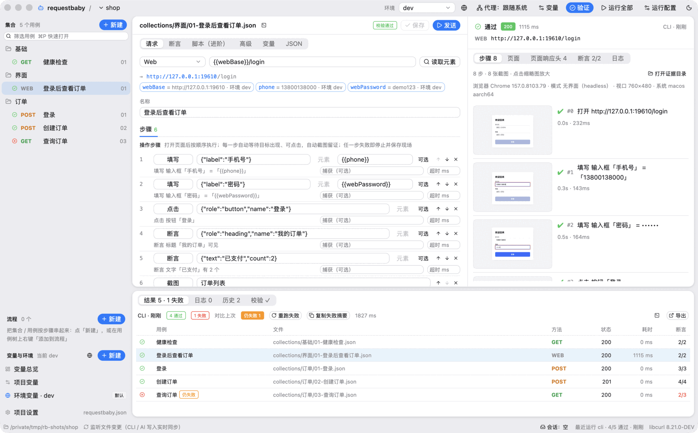
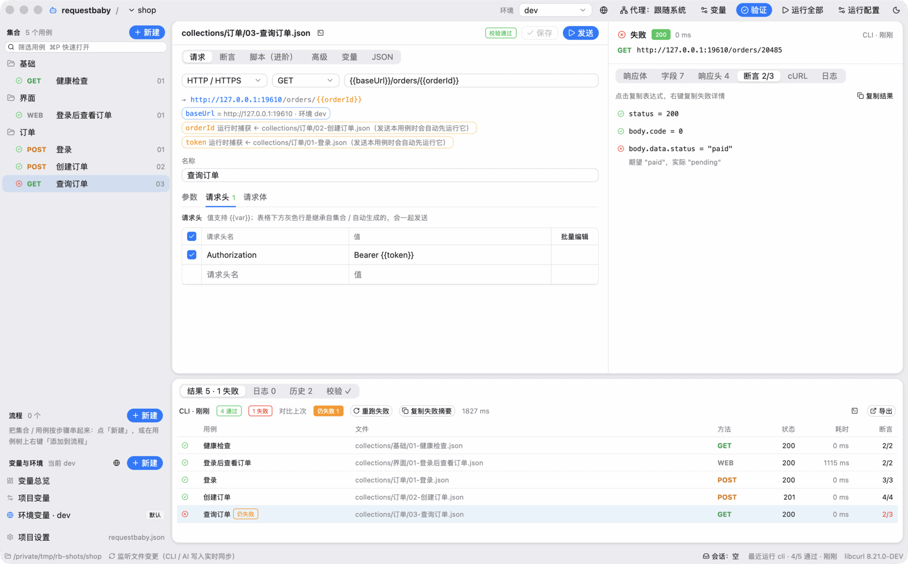
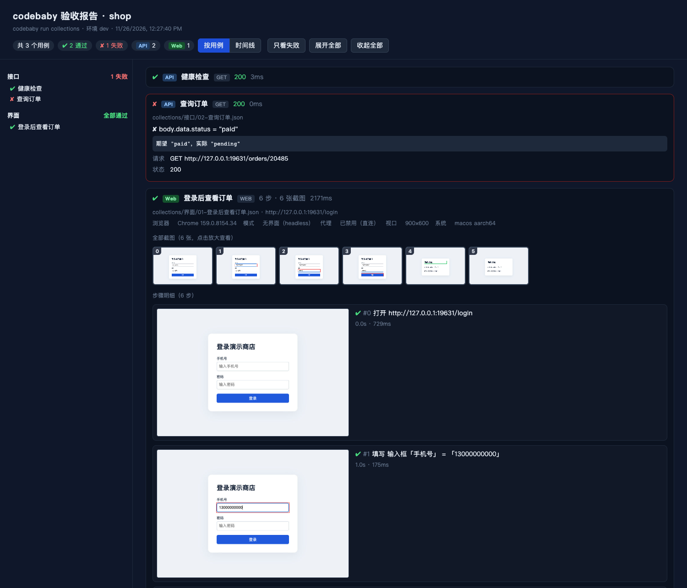

# requestbaby

AI 交付的独立验收层，辅助人对 AI 交付的成果验收。

用 JSON 文件写下「发什么请求、点哪些按钮，应该得到什么结果」，requestbaby 真的去跑一遍，告诉你通过还是失败。接口（HTTP / gRPC / WebSocket）和界面（Web / Android / Mac 桌面应用）都能验收，界面验收的每一步都会截图留证。

有命令行，也有 macOS 桌面端，两边读写同一个项目目录。

[官网](https://apps.zhizuzhefu.com/requestbaby/) · [下载安装](#下载安装) · [快速上手](#快速上手) · [最新版本](https://github.com/zhizuzhefu/requestbaby/releases/latest)



## 适合谁用

- 让 AI 写后端或前端，想自己握有一套验收标准，不用逐行读代码的人
- 想把接口检查、界面检查放进 CI 的团队（`--report junit` 直接进测试面板；CI 机器是 Linux 时目前要从源码构建，见「放进 CI」）
- 需要给测试结果留证据的场合：请求响应记录、每一步的截图、可以直接转发的报告
- 还有一种次要的用法：同一套界面步骤加上循环和通知，就能盯着某个页面、手机里的某个界面，发现变化时提醒你（见下面「步骤里有重复」一条）；主线仍是验收，监控只是它的延伸，不是另一个产品

## 能做什么

**验收接口**

- HTTP / HTTPS、gRPC、WebSocket。gRPC 用服务端反射或 `.proto` 文件，不用生成代码；WebSocket 可以逐步发送、接收、断言
- 断言状态码、响应头，以及响应体里的任意字段
- 登录拿到的 token 之类的值可以存成变量，后面的用例直接用
- 环境：dev / test / prod 各有一套地址和账号；密钥放在不入库的本机文件里
- 把几个集合按顺序串成流程；一个用例可以按多组数据重复运行
- 流程之间可以有依赖：登录做成一个流程，业务流程用 `needs` 依赖它，登录态（Cookie、localStorage / sessionStorage、捕获的变量）沿用到后面所有步骤，不用每个流程重复登录；步骤的 `as` 切换用户，每个用户的登录态各自独立
- 从 OpenAPI / Swagger / Postman / cURL 导入现成的接口

**验收界面**

- Web：直接驱动本机的 Chrome / Edge，不需要 Playwright 或 Node；也可以连 Docker、云端的远程浏览器
- Android：通过 adb 操作真机或模拟器，远程模拟器、云手机也可以
- Mac 桌面应用：通过 [agent-desktop](https://github.com/vercel-labs/agent-desktop) 读取系统无障碍树来操作，默认不抢焦点、不动鼠标
- 按人看到的样子找元素（名叫「登录」的按钮、标签是「手机号」的输入框），自动等元素就绪再操作，不用写 sleep
- 界面结构里读不到文字的页面（微信小程序、自绘控件、远程桌面）：按屏幕上看到的文字定位、断言、取值——对截图做文字识别（OCR），在本机完成，不调用大模型；Android 还能接管设备当前停着的页面，不重启应用
- 步骤里有重复（按次数 / 时长，满足条件提前结束）、条件分支、随机等待，发现目标或失败时发通知（本机通知、日志、webhook，不运行任何命令）：拿来做定时轮询、盯号源、盯上线状态
- 每一步自动截图，并框出点了哪里、验证了哪个元素；失败时另存页面、控制台、网络请求（Android 是界面结构和 logcat，Mac 桌面是无障碍树）
- HTML 报告是单个文件，截图已经嵌在里面，发给别人直接打开

**结果与协作**

- 命令行退出码就是结论，方便放进 CI；也可以输出 JSON 或 HTML 报告
- 一键导出结果给别人：桌面端「导出结果」（⌘E），命令行 `requestbaby export`。默认是全部用例的最新结果，一份 HTML，截图已嵌入，对方用浏览器直接打开；导出前会提示哪些用例没跑过、哪些结果已是旧的。API、Web、Android、Mac 桌面用例可以放进同一个流程，变量在各端之间传递，报告是一个整体：每个用例标出所属的端，多端混合时有按真实先后排列的时间线，失败现场（页面结构、控制台、网络请求、logcat）直接嵌在里面
- 保留运行历史，记录每次运行对应的代码提交；同一个提交上时过时不过的用例会标成「不稳定」
- 桌面端可以可视化地编辑用例、看响应和截图，每个操作都有对应的命令
- 所有对外连接可以统一走代理（socks5 / http），也可以一键关掉
- 判断通过与否不调用大模型，不消耗 token，同样的用例每次得到同样的结论
- 单个可执行文件，运行时不依赖其他软件

## 从 Postman 过来

只想日常调接口也可以：桌面端用表单构造请求（任意方法、查询参数、请求头；Body 支持 JSON、表单、form-data 文件上传、raw），发送后看状态码、耗时、响应体、响应头和等价的 cURL；环境变量、token 传递、Cookie、集合、批量运行都有，不用先学 JSON。

| Postman | requestbaby |
|---------|-------------|
| Collection / Folder | 集合：`collections/` 下的目录，一个用例一个 JSON 文件 |
| Environment / Globals | 环境（dev / test / prod）与变量，写法同样是 `{{变量}}` |
| Tests 里的断言 | 「断言」页：状态码、响应头、响应体任意字段 |
| Pre-request / Tests 脚本 | 「脚本（进阶）」页：JS 脚本，API 与 `pm.*` 不同 |
| Collection Runner / Newman | 「运行全部」，命令行 `requestbaby run` / `verify` |
| Import | 导入 cURL、Postman、OpenAPI / Swagger |
| Workspace 同步 | 用例是普通文件，用 git 共享和评审 |

## 运行起来是什么样

接口用例失败时，直接告诉你差在哪：断言了什么、期望什么、实际是什么。



界面用例的每一步都有截图，红框是操作或验证的位置。运行后生成的 HTML 报告是单个文件，截图已经嵌在里面，发给同事或贴到工单里直接能看：



## 下载安装

所有安装包都在 [Releases](https://github.com/zhizuzhefu/requestbaby/releases/latest) 页面。

| 你要装的 | 下载 | 说明 |
|----------|------|------|
| macOS 桌面端 | `requestbaby-<版本>.dmg` | 已签名并通过 Apple 公证，macOS 12 以上 |
| 命令行，macOS（Apple 芯片） | `requestbaby-aarch64-apple-darwin.tar.gz` | |
| 命令行，macOS（Intel） | `requestbaby-x86_64-apple-darwin.tar.gz` | |

每个安装包旁边有同名的 `.sha256` 文件，可以用来校验下载是否完整。目前只提供 macOS 版（桌面端与命令行）。

### 桌面端

打开 DMG，把 requestbaby 拖进「应用程序」。桌面端自带命令行：在菜单里选「安装命令行工具」，终端里就能直接用 `requestbaby` 命令。

### 命令行

以 macOS Apple 芯片为例，其他平台换成对应的文件名：

```bash
curl -LO https://github.com/zhizuzhefu/requestbaby/releases/latest/download/requestbaby-aarch64-apple-darwin.tar.gz
tar -xzf requestbaby-aarch64-apple-darwin.tar.gz
sudo mv requestbaby /usr/local/bin/
requestbaby --version
```

### 升级

桌面端会自动更新：启动时和运行期间每 6 小时在后台检查，发现新版本就自动下载并完整校验（SHA256、签名、团队、公证、能运行），退出时自动安装；手动「检查更新」下载完成后只有一个选项「安装并更新」（右下角状态栏的「安装并更新」也是点一下就装）。任何一步失败都保留当前版本。命令行运行 `requestbaby upgrade`：独立安装的会下载、校验后替换自己，在 App 里的命令行走同一套自动更新；加 `--check` 只检查不安装。

### 从源码构建

需要 Rust（rustup）和 cmake：

```bash
cargo install --locked --path crates/requestbaby-cli       # 命令行
make mac-app && make install-mac                            # macOS 桌面端，装到 /Applications
```

### 运行环境

- Web 用例需要本机装有 Chrome、Edge 或 Chromium（或者连接远程浏览器）
- Android 用例需要 [adb](https://developer.android.com/tools/releases/platform-tools)，以及一台开着调试的设备或模拟器
- Mac 桌面用例需要 `npm install -g agent-desktop`，并给运行 requestbaby 的程序（终端 / requestbaby.app）开启「辅助功能」（截图还需要「屏幕录制」）权限

`requestbaby doctor` 会检查这些是否就绪。

## 快速上手

```bash
requestbaby init myapi --base-url http://localhost:8080     # 生成项目：dev / prod 环境、示例用例；被测服务地址写进 dev
cd myapi                                                    # 地址以后要改：requestbaby vars set baseUrl <地址> -e dev
requestbaby new case collections/orders 创建订单 -m post    # 新建一个用例
requestbaby send collections/orders/01-创建订单.json --suggest   # 发一次，看真实响应，并给出断言建议
requestbaby run                                             # 跑全部用例
requestbaby open                                            # 在桌面端打开这个项目
```

已有接口的话：`requestbaby new case <目录> --curl "curl …"` 可以把浏览器里复制的 cURL 变成用例，`requestbaby import openapi.json` 可以导入 OpenAPI / Swagger / Postman 文件。

## 一个用例长什么样

一个 JSON 文件就是一个用例，放在 `collections/` 下，文件名顺序就是运行顺序。

```json case
{
  "name": "登录",
  "request": {
    "method": "POST",
    "url": "{{baseUrl}}/auth/login",
    "body": { "json": { "username": "{{username}}", "password": "{{password}}" } }
  },
  "expect": {
    "status": 200,
    "body": {
      "code": 0,
      "data.token": { "type": "string" }
    }
  },
  "capture": { "token": "data.token" }
}
```

这个用例向环境里配置的 `baseUrl` 加 `/auth/login` 发一个 POST，期望状态码是 200、响应体里 `code` 等于 0、`data.token` 是字符串，并把 `data.token` 存成变量 `token`，后面的用例写 `{{token}}` 就能用。

失败的时候，报告会直接写出差在哪：`body.code = 0 → 期望 0，实际 4030001`。

界面用例的写法类似，把请求换成一步一步的操作：

```json case
{
  "name": "登录后看到订单",
  "web": {
    "url": "{{webBase}}/login",
    "steps": [
      { "fill": { "label": "手机号" }, "value": "{{phone}}" },
      { "fill": { "label": "密码" }, "value": "{{password}}" },
      { "click": { "role": "button", "name": "登录" } },
      { "expect": { "role": "heading", "name": "我的订单" } }
    ]
  }
}
```

运行后，每一步都有一张截图，保存在 `.requestbaby/runs/` 下；加上 `--report html` 会得到一份带截图时间线的单文件报告。Android 用例把 `web` 换成 `android`，写应用包名和操作步骤即可；Mac 桌面应用换成 `desktop`，写应用名称（如 `TextEdit`）。

## 放进 CI

`requestbaby verify --plan` 先查看执行计划。用 `--workflow` 选定验收流程，可重复用 `--require-case` 指定必验文件。运行后，报告列出必验覆盖和未验原因。退出码 0 表示必验通过，1 表示用例失败，2 表示验收不完整。

```yaml
- run: requestbaby verify --workflow smoke -e ci --report json > verify.json
```

被测服务需要由 CI 先启动。

### 给 CI 的测试面板用：JUnit XML

`--report junit` 把结果写成 JUnit XML 到标准输出（`run`、`workflow`、`verify` 都支持），GitLab、Jenkins、GitHub Actions 的测试面板直接读：断言不成立是 `failure`，连不上服务 / 界面步骤出错是 `error`，跳过是 `skipped`，一个目录一个 testsuite。

```bash
requestbaby run --report junit > junit.xml        # 退出码照常：0 通过 / 1 有用例失败 / 2 无法完成
```

### Linux 上用

目前不提供 Linux 预编译包，Linux 上从源码构建：`cargo install --locked --path crates/requestbaby-cli`（需要 Rust 和 cmake；只构建命令行，不含桌面端）。源码层面支持 Linux，但还没有在真实的 Linux 机器上验证过，遇到问题请到 [Issues](https://github.com/zhizuzhefu/requestbaby/issues) 反馈。Linux 上接口（HTTP / gRPC / WebSocket）、Web（本机 Chrome / Chromium）和 Android（adb）用例理论上都能跑，屏幕文字识别（`ocr`）和 Mac 桌面应用用例只在 macOS 上可用。

## 和 AI 配合

让 AI 写用例的话，先让它读 `requestbaby guide`，那是一页写法速查，读完就能写出能通过校验的用例。桌面端右上角「⋯」菜单里有「复制用例写法速查」，可以直接贴进对话。`requestbaby init` 生成的 `AGENTS.md` 和 `CLAUDE.md` 也写好了这条约定，Claude Code、Codex 等工具在项目目录里会自动读到。

AI 写完之后，`requestbaby validate` 会检查用例并给出写法建议，`requestbaby fmt --fix` 可以一键改写。

## 文档

文档随程序一起安装，版本始终和你装的一致：`requestbaby guide <主题>`。同样的内容在 [docs/guide](docs/guide/)：

| 想了解 | 主题 |
|--------|------|
| 断言怎么写 | [expect](docs/guide/expect.md) |
| 把登录的 token 传给后面的用例 | [capture](docs/guide/capture.md)、[auth](docs/guide/auth.md) |
| 变量与环境 | [vars](docs/guide/vars.md)、[env](docs/guide/env.md) |
| 多个用例串成流程、按多组数据运行 | [flow](docs/guide/flow.md)、[data](docs/guide/data.md) |
| gRPC / WebSocket | [grpc](docs/guide/grpc.md)、[ws](docs/guide/ws.md) |
| Web / Android / Mac 桌面界面验收 | [web](docs/guide/web.md)、[android](docs/guide/android.md)、[desktop](docs/guide/desktop.md) |
| 代理 | [proxy](docs/guide/proxy.md) |
| 全部命令 | [cli](docs/guide/cli.md)，或 `requestbaby --help` |

## 参与开发

```bash
cargo test --workspace
cargo clippy --workspace --all-targets -- -D warnings
```

项目结构见 [docs/ARCHITECTURE.md](docs/ARCHITECTURE.md)。发现问题或有建议，欢迎提 [Issue](https://github.com/zhizuzhefu/requestbaby/issues)。

## 许可

[MIT](LICENSE)
